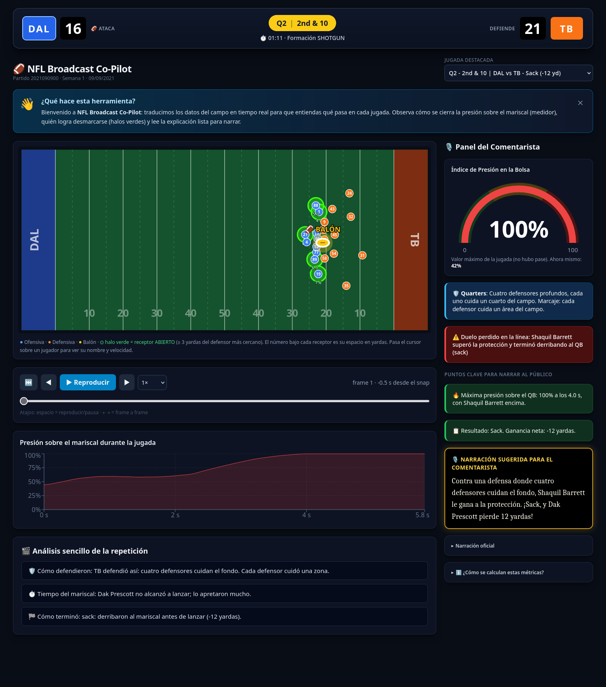

# NFL Broadcast Co-Pilot

Construimos **NFL Broadcast Co-Pilot**, una app web (FastAPI + React) que reproduce frame a frame una jugada del Big Data Bowl en una cancha animada, con un panel lateral pensado para quien narra el partido. Revela en tiempo real dos métricas propias: el **Índice de Presión en la Bolsa** (de 0 a 100%, según qué tan cerca está el pass rusher más cercano del QB) y la **ventana de separación** de cada receptor, que se marca como ABIERTO con un halo verde desde 3 yardas de ventaja sobre su defensor. El panel traduce la cobertura defensiva, los duelos perdidos en la línea (bloqueador superado, sack o presión) y los puntos clave de la jugada a español claro y sin jerga. Lo usarían comentaristas deportivos para explicar jugadas complejas al aire y nuevos aficionados de la NFL que quieren entender qué pasó sin saber de tácticas. Para verlo, corre `uvicorn backend.main:app` y abre el puerto 8000 (el dashboard compilado se sirve ahí mismo).
